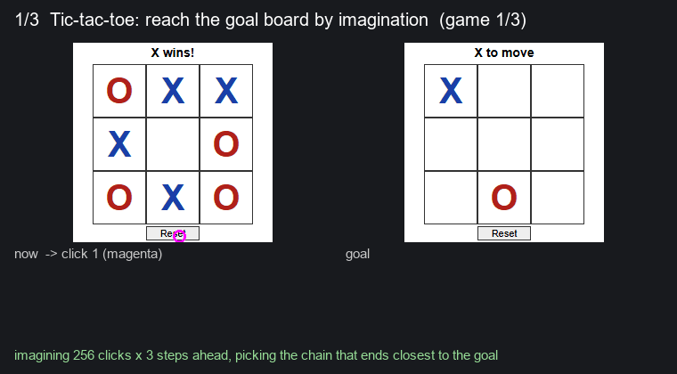

# GUI world model: predicting the next screen

GPT learns language by predicting the next word. This is a small experiment asking a similar question for software:
can a model learn how an app works by predicting the **next screen** after a click or key press, and then use that
to act?

It is a weekend side project, early and unfinished. Results below are on toy apps and games.



## How it works

1. **Eyes.** A frozen DINOv2-S turns each screenshot into 256 patch vectors: `z_t = DINOv2(s_t)`.
2. **Imaginer.** A small transformer (4 layers, about 3.5M parameters) predicts what changes after an action:
   `z_{t+1} = z_t + delta(z_t, a_t)`. It is trained on its own random clicks, no labels.
3. **Acting by imagination.** To reach a goal screen, imagine every candidate action and take the one whose imagined
   screen is closest to the goal: `a* = argmin_a d(f(z_t, a), z_goal)`.

## Results so far (held-out data)

| Test | Result |
|---|---|
| Tic-tac-toe: predict the next board | 99.3% correct on changed clicks |
| Tic-tac-toe: reach a goal 1 click away by imagination | 99.8%, 28 ms per decision |
| Tic-tac-toe: goals 2 to 5 clicks away (lookahead 3) | 86% |
| Snake: play by imagination | 3.45 food per game (random: 0.20) |
| Tetris: predict the next board | 71% of changed cells right |
| Settings app: predict the next screen | 93.5% |
| File manager: predict the next screen | 37% (folder contents are hidden, needs memory) |
| 1,100 generated mini-apps, test on 100 unseen | 8 / 23 / 37 / 41 / 42% right next screen at 10 / 30 / 100 / 300 / 1,000 training apps |

Open questions: does more (and more varied) data make it generalize to unseen apps, or does it keep flattening?
Can it learn a new app from a few tries in context? What breaks when moving from toys to real software?

## Layout

- `level0/model.py`: Eyes, Imaginer, Inverse model
- `level0/*.html`: the apps and games (tic-tac-toe, Snake, Paint, Settings, Files, generated TinyApps)
- `level0/*_collect.py`: drive an app in headless Chromium (Playwright) and record screen, action, next screen
- `level0/*encode*.py`: turn screenshots into DINOv2 features
- `level0/*train*.py`, `level1.py`, `level2.py`, `*_act.py`, `snake_play.py`: training and acting
- `level0/tetris/`: a local Tetris game plus its collect / encode / train scripts
- `results/`: logs, metrics and figures from the runs

## Running it

```
pip install -r requirements.txt        # plus PyTorch with CUDA
python -m playwright install chromium
python level0/hf_data.py fetch lamshiu/gui-world-model-data level0,snake,tetris
python level0/encode.py                 # and the other encode scripts for the sets you use
python level0/demo.py live              # watch it play; also writes results/demo.gif
```

Data (screenshots, actions, checkpoints) is on the Hugging Face Hub:
[lamshiu/gui-world-model-data](https://huggingface.co/datasets/lamshiu/gui-world-model-data) (CC BY 4.0).
Collect and test on the same renderer: Windows and Linux Chromium draw fonts slightly differently, and that alone
drops the planner from 88% to 63%.

Feedback is very welcome, especially on where you think this breaks.

## License

MIT, see [LICENSE](LICENSE). The data on the Hub is CC BY 4.0.
